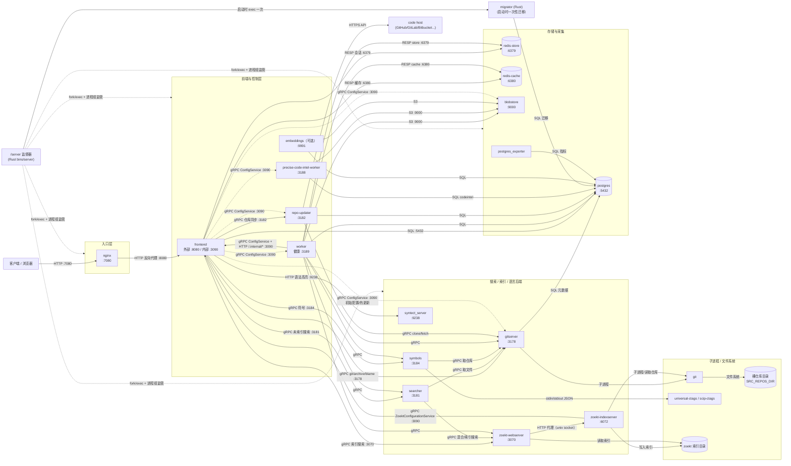
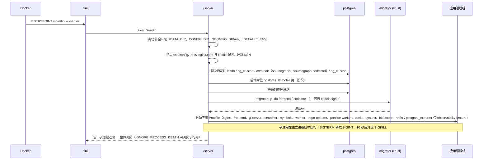
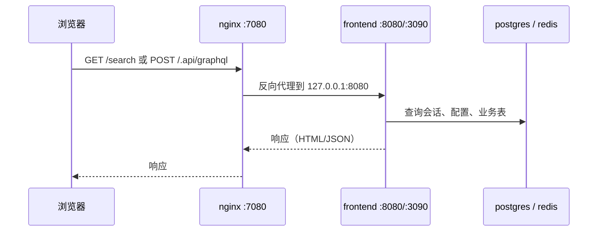

# 2. 进程架构与通信关系

本文描述「Rust 版 Sourcegraph 单容器镜像」跑起来所需的全部进程、它们的父子关系、
监听端口以及互相之间如何通信。

## 2.1 进程总览图

```mermaid
flowchart TB
    browser["浏览器 / API 客户端"]

    subgraph container["容器（sourcegraph/server:rust）"]
        tini["tini (PID 1)<br/>/sbin/tini"]
        server["server (Rust)<br/>/server 监督器"]

        subgraph entry["对外入口"]
            nginx["nginx<br/>:7080"]
        end

        subgraph app["Rust 服务进程"]
            frontend["frontend<br/>外部 :8080 / 内部 :3090"]
            gitserver["gitserver<br/>:3178"]
            searcher["searcher<br/>:3181"]
            symbols["symbols<br/>:3184"]
            worker["worker<br/>健康 :3189"]
            repoupdater["repo-updater<br/>:3182"]
            precise["precise-code-intel-worker<br/>:3188"]
            embeddings["embeddings（可选）<br/>:9991"]
        end

        subgraph index["索引与语言服务"]
            zoektidx["zoekt-sourcegraph-indexserver<br/>:6072"]
            zoektweb["zoekt-webserver<br/>:3070"]
            syntect["syntect_server<br/>:9238"]
            ctags["universal-ctags / scip-ctags<br/>（子进程）"]
        end

        subgraph store["存储与基础设施"]
            postgres[("postgres<br/>127.0.0.1:5432")]
            redisstore[("redis-store<br/>:6379")]
            rediscache[("redis-cache<br/>:6380")]
            blobstore["blobstore (Rust)<br/>:9000"]
            pg_exporter["postgres_exporter"]
        end

        subgraph optional["可选观测（默认关闭）"]
            prom["prom-wrapper (Rust) / prometheus / alertmanager"]
            grafana["grafana"]
        end

        migrator["migrator (Rust)<br/>一次性迁移"]
    end

    browser -->|HTTP| nginx
    tini --> server
    server -.->|Procfile 子进程| nginx
    server -.-> frontend
    server -.-> gitserver
    server -.-> searcher
    server -.-> symbols
    server -.-> worker
    server -.-> repoupdater
    server -.-> precise
    server -.-> zoektidx
    server -.-> zoektweb
    server -.-> syntect
    server -.-> blobstore
    server -.-> redisstore
    server -.-> rediscache
    server -.-> postgres
    server -.-> pg_exporter
    server -.-> embeddings
    server -.-> prom
    server -.-> grafana
    server -->|一次性| migrator
```

说明：

- `tini` 是 PID 1，只负责信号转发与僵尸回收；`/server` 是真正的父进程。
- `/server` 用「Procfile + 进程组」方式拉起子进程（等价 Go 的 goreman），任一子
  进程退出会触发整体关闭（除非 `IGNORE_PROCESS_DEATH=true`）。
- 灰色虚线表示「由 `/server` 拉起」，不是本进程内的线程。
- `migrator` 只在启动阶段运行一次，迁移完成后退出。

## 2.2 进程依赖与通信通道图

下图把「依赖关系」和「通信通道」画在一起：**实线**表示运行期的请求/数据通道
（边上标注协议与端口），**虚线**表示启动/生命周期依赖（`/server` 的 fork/exec
监管、服务向 frontend 拉取初始配置）。箭头方向是「调用方 → 被调用方/被依赖方」。

图例与要点：

- **实线** = 运行期通信：HTTP（仅入口/nginx→frontend、syntect、blobstore S3）、
  gRPC（Rust 服务之间的主要通道）、PostgreSQL SQL、Redis RESP、子进程 stdio/
  文件系统；
- **虚线** = 生命周期/启动依赖：`/server` 负责拉起并监管所有常驻进程；gitserver、
  repo-updater、worker、precise-worker 启动时还会阻塞等待 frontend 的
  `ConfigService` 初始配置（Postgres DSN、服务连接等），因此 frontend 必须在它们
  之前就绪；Rust `blobstore` 不依赖 frontend 配置服务，绑定后即可服务 S3
  请求；
- `searcher`、`symbols` 不经过 frontend 配置服务，直接按 `SRC_GIT_SERVERS` 等
  环境变量访问 gitserver；
- `zoekt-indexserver` 使用 **gRPC `ZoektConfigurationService`**（`List`/
  `SearchConfiguration`/`UpdateIndexStatus`）访问 frontend 内部地址来获取仓库
  列表与配置，按需 fork `zoekt-git-index` 写索引；
  `zoekt-webserver` 只读索引并向 frontend/searcher 提供查询（`DocumentRanks`
  暂返回空 ranks，即不使用离线排序）；
- `ctags`、`git` 不是常驻进程：由 `symbols` / `gitserver` / zoekt 索引器按需
  spawn，签名分别为 ctags 的交互式 JSON 协议与 git 子命令；
- `packaged` 环境里 frontend 与 gitserver/searcher/symbols/repo-updater 的调用
  都走 gRPC；HTTP 只用于 nginx 反代、syntect 高亮、blobstore 的 S3 接口以及
  外部 Code Host 请求。

## 2.3 通信方式矩阵

| 源 → 目标 | 协议 | 默认地址 | 配置入口 | 用途 |
| --- | --- | --- | --- | --- |
| 浏览器 → nginx | HTTP/HTTPS | `:7080` | 生成的 `nginx.conf` 固定 `listen 7080`（`SRC_NGINX_HTTP_ADDR` 仅设默认值） | 唯一对外入口 |
| nginx → frontend | HTTP 反向代理 | `127.0.0.1:8080` | `SRC_HTTP_ADDR`（生成的 `nginx/sourcegraph_backend.conf`） | UI、`/.api`、GraphQL |
| frontend → gitserver | gRPC | `:3178` | `SRC_GIT_SERVERS` | 读取 Git 对象、archive、blame、commit/diff（`sg_git::GitserverClient`） |
| frontend → searcher | gRPC（流式） | `http://127.0.0.1:3181` | `SEARCHER_URL` | 未索引搜索（`index:no`） |
| frontend → symbols | gRPC（同一端口也提供 HTTP 回退） | `http://127.0.0.1:3184` | `SYMBOLS_URL` | 符号搜索、代码智能 |
| frontend → zoekt-webserver | gRPC | `127.0.0.1:3070` | `INDEXED_SEARCH_SERVERS` / `ZOEKT_HOST` | 索引搜索、符号查询 |
| frontend → syntect_server | HTTP | `http://127.0.0.1:9238` | `SRC_SYNTECT_SERVER` | 语法高亮 |
| frontend → repo-updater | gRPC | `http://127.0.0.1:3182` | `REPO_UPDATER_URL` | `EnqueueRepoUpdate` 等管理操作 |
| frontend → postgres | PostgreSQL 线协议 | `127.0.0.1:5432` | `PGHOST/PGUSER/PGDATABASE/PGSSLMODE`；代码智能用 `CODEINTEL_PG*` | 全部业务数据 |
| frontend → redis-store | RESP | `127.0.0.1:6379` | `REDIS_STORE_ENDPOINT`（否则 `REDIS_ENDPOINT`） | 会话、持久键值 |
| frontend → redis-cache | RESP | `127.0.0.1:6380` | `REDIS_CACHE_ENDPOINT` | 缓存、限流、feature flag 求值 |
| gitserver → postgres | PostgreSQL | `127.0.0.1:5432` | `PG*` | `gitserver_repos` 等元数据 |
| gitserver → git | 子进程 | `/usr/bin/git` | `SRC_REPOS_DIR` | 裸仓库操作 |
| searcher → gitserver | gRPC | `:3178` | `SRC_GIT_SERVERS` | 按需拉取文件内容 |
| searcher → zoekt-webserver | gRPC（混合搜索） | `127.0.0.1:3070` | `INDEXED_SEARCH_SERVERS` | 混合/索引搜索分支（镜像内 `DISABLE_HYBRID_SEARCH=true`，默认不启用） |
| symbols → gitserver | gRPC | `:3178` | `SRC_GIT_SERVERS` | 读取仓库文件 |
| symbols → ctags | 子进程（stdin/stdout JSON） | `universal-ctags` / `scip-ctags` | `CTAGS_COMMAND`、`SCIP_CTAGS_COMMAND` | 符号解析 |
| worker → frontend（内部） | gRPC `ConfigService` + HTTP `/.internal/{graphql,search/stream,compute/stream}` | `127.0.0.1:3090` | `SRC_FRONTEND_INTERNAL` | 初始配置（gRPC）；批量变更 webhook / insights 搜索走 `/.internal/*` HTTP（内部监听器同时接受带/不带前缀两种路径） |
| gitserver / repo-updater / worker / precise-worker → frontend（内部） | gRPC `ConfigService` | `127.0.0.1:3090` | `SRC_FRONTEND_INTERNAL` | 获取初始配置与热更新（含 Postgres DSN、服务连接等）；服务启动时阻塞等待首个配置 |
| blobstore → frontend | 无 | — | — | Rust `blobstore` 只读写本地 `$DATA_DIR/blobstore`，不建立配置连接 |
| prom-wrapper → frontend（内部，观测开启时） | gRPC `ConfigService` | `127.0.0.1:3090` | `SRC_FRONTEND_INTERNAL` | 订阅站点配置，生成 Alertmanager receivers/routes/SMTP/silences |
| worker → gitserver / searcher / symbols / zoekt | gRPC | 同上各端口 | 同上 | 作业执行所需的各后端 |
| worker / precise-worker → blobstore | S3 API（HTTP） | `http://127.0.0.1:9000` | precise-worker 读 `PRECISE_CODE_INTEL_UPLOAD_*`；worker 由作业装配注入对象存储配置（字段同第 10 节） | 上传与读取索引 |
| repo-updater → code host | HTTPS | 由站点配置/外部服务决定 | `HTTPS_PROXY` 等 | 拉取仓库、同步元数据 |
| repo-updater → gitserver | gRPC | `:3178` | `SRC_GIT_SERVERS` | 触发 clone/fetch |
| zoekt-indexserver → frontend（内部） | gRPC `ZoektConfigurationService` | `http://127.0.0.1:3090` | `-sourcegraph_url` 参数 | 拉取仓库列表/配置、上报索引状态（`List`/`SearchConfiguration`/`UpdateIndexStatus` 已实现；`DocumentRanks` 返回空 ranks） |
| zoekt-indexserver → git / 索引目录 | 子进程 + 文件系统 | `/var/opt/sourcegraph/zoekt/index` | `-index` 参数 | 构建索引 |
| zoekt-webserver → zoekt-indexserver | HTTP（经 unix socket 代理 `/indexserver/` 路径） | `<index>/indexserver.sock` | `-indexserver_proxy` | 索引器调试/管理接口代理（`-listen 127.0.0.1:6072` 只是索引器自己的 HTTP debug 端口） |
| precise-worker → postgres | PostgreSQL | `127.0.0.1:5432` | `PG*`、`CODEINTEL_PG*` | 上传任务与索引元数据 |
| embeddings → postgres / 对象存储 | PostgreSQL / S3 | `:5432` / `:9000` | `PG*`、`EMBEDDINGS_UPLOAD_*` | 嵌入索引 |
| postgres_exporter → postgres | PostgreSQL | `127.0.0.1:5432` | `DATA_SOURCE_NAME` | 指标采集 |
| `/server` → 子进程 | fork/exec（`/bin/sh -c "exec ..."`） | — | Procfile | 启动/监管 |
| 运维 → `/server` | Unix 信号 | — | `SIGINT/SIGTERM/SIGHUP` | 优雅关闭 |

> 内部 GraphQL（`:3090`）没有路径前缀限制，实际路径是 `/graphql`；外部
> `/ .api/graphql` 走 nginx → frontend `:8080`。

## 2.4 端口一览

| 端口 | 进程 | 是否对外 | 覆盖变量 |
| --- | --- | --- | --- |
| 7080 | nginx | 是（镜像默认发布） | 固定的 `listen 7080`（`SRC_NGINX_HTTP_ADDR` 默认同为 `:7080`） |
| 8080 | frontend 外部 HTTP | 仅容器内/宿主映射 | `SRC_HTTP_ADDR`（`sg-entry` 默认 `:8080`） |
| 8443 | 无进程实际监听（基线遗留 `SRC_HTTPS_ADDR`） | 否 | `SRC_HTTPS_ADDR` |
| 3090 | frontend 内部 HTTP API | 否 | `SRC_HTTP_ADDR_INTERNAL` |
| 3178 | gitserver | 否 | `GITSERVER_ADDR` |
| 3181 | searcher | 否 | `SEARCHER_ADDR` |
| 3182 | repo-updater（gRPC） | 否 | `REPO_UPDATER_URL`（客户端侧） |
| 3184 | symbols | 否 | 常量 |
| 3188 | precise-code-intel-worker（健康/调试） | 否 | 无（常量） |
| 3189 | worker 健康检查 | 否 | 常量 |
| 3070 | zoekt-webserver（gRPC/RPC 搜索） | 否 | `INDEXED_SEARCH_SERVERS` / `ZOEKT_HOST` |
| 6072 | zoekt-indexserver（HTTP debug/pprof） | 否 | Procfile 参数 |
| 9238 | syntect_server | 否 | `SRC_SYNTECT_SERVER` |
| 5432 | postgres | 否（`listen_addresses=127.0.0.1`） | `PGPORT` |
| 6379 | redis-store | 否 | `REDIS_STORE_ENDPOINT` |
| 6380 | redis-cache | 否 | `REDIS_CACHE_ENDPOINT` |
| 9000 | blobstore | 否 | `S3PROXY_ENDPOINT` |
| 9991 | embeddings（条件启用） | 否 | 常量 |
| 9090 / 3370 | prometheus / grafana（默认关闭） | 否 | `DISABLE_OBSERVABILITY` |
| 9187 | postgres_exporter（默认） | 否 | postgres_exporter 自身参数 |
| 6063/6068/6069/6071/6074/6088/6089/6099 | 各服务 pprof/debug（默认不监听） | 否 | `SRC_PROF_HTTP`、`SRC_PROF_SERVICES` |

## 2.5 启动时序

关键点：

1. **环境合并顺序**：进程环境 → `$CONFIG_DIR/env`（`set_default`，不覆盖已有值）
   → `DATA_DIR`/`CONFIG_DIR`/缓存目录默认值 → `DEFAULT_ENV` → 生成的 DSN/服务地址。
2. **Postgres 初始化**只在 `DATA_DIR/postgresql` 不存在时执行；通过
   `postgresql-markers/*` 记录已创建的数据库（`sourcegraph`、
   `sourcegraph-codeintel`，以及 `ALLOW_SINGLE_DOCKER_CODE_INSIGHTS=true` 时的
   `sourcegraph-codeinsights`）。
3. **迁移**：`migrator` 由 Rust 实现（`sg-bin-migrator` + `sg-migrator`），
   全部子命令与迁移谱系均在本地执行；镜像不再随附 `migrator-go`。
4. **5.1 重建门禁**：本地 Postgres 且缺少
   `DATA_DIR/postgresql/5.1-reindex.completed` 时，必须设置
   `SOURCEGRAPH_5_1_DB_MIGRATION=true`，否则进程以退出码 `101` 退出并打印指引。
5. **PGRESTORE**：为 `true` 时只启动 postgres，便于从备份恢复，不跑迁移。
6. **配置依赖顺序**：gitserver、repo-updater、worker、precise-code-intel-worker
   启动时会先通过 gRPC 向 frontend 内部地址（`SRC_FRONTEND_INTERNAL`，
   即 `127.0.0.1:3090`）的 `ConfigService` 拉取初始配置（含 Postgres DSN 与
   服务连接），在 frontend 提供配置之前这些进程会阻塞等待；Rust `blobstore`
   直接监听本地端口，不参与该配置依赖。Procfile 中 frontend 排在 gitserver
   等进程之前，正是为了满足该顺序。

## 2.6 典型请求链路

### 2.6.1 页面/GraphQL

### 2.6.2 搜索

- **未索引搜索**：frontend → searcher `:3181` → searcher 按需从
  gitserver `:3178` 取文件内容。
- **索引搜索**：frontend → zoekt-webserver `:3070`；索引由
  zoekt-indexserver 定期通过 gRPC `ZoektConfigurationService` 从 frontend 内部
  地址拉取仓库列表/配置后构建。
- **符号搜索**（`type:symbol`，hover 的 definition/references 依赖）：
  searcher/symbols → `symbols:3184` → 按语言选择 `scip-ctags` 或
  `universal-ctags`，仓库内容来自 gitserver。
  非 scip 支持语言（C/C++、Markdown 等）必须要有 `universal-ctags`，否则会报
  `spawn universal-ctags: No such file or directory`。

### 2.6.3 后台作业

worker `:3189`（仅健康检查）启动后通过 `SRC_FRONTEND_INTERNAL=127.0.0.1:3090`
的 gRPC `ConfigService` 获取初始配置，部分作业还会请求 HTTP
`/.internal/graphql|search/stream|compute/stream`；业务数据主要直连
Postgres，并访问 gitserver/searcher/symbols/zoekt/blobstore/Redis。精确代码智能上传由 precise-code-intel-worker `:3188` 处理，索引
文件写入 blobstore `:9000`。

## 2.7 关键依赖关系（排障顺序）

1. `postgres` 5432 可连、迁移已跑完（否则前端直接启动失败）；
2. `redis-store` 6379 / `redis-cache` 6380 可连（连接失败通常降级为无缓存/无限流，
   但会话功能不可用）；
3. `gitserver` 3178 是几乎所有读路径的基础；它依赖 `SRC_REPOS_DIR` 与 git；
4. `searcher`/`symbols`/`zoekt` 只影响相应搜索能力，不影响登录与页面框架；
5. `syntect_server` 9238 缺失会导致语法高亮失败（页面仍可读）；
6. `universal-ctags`/`scip-ctags` 缺失会使符号搜索与 hover 跳转失效；
7. `blobstore` 9000 缺失会影响精确代码智能上传/读取；
8. nginx 7080 是唯一对外入口，前端 8080 正常但 7080 不通时先看 nginx 与
   `SRC_HTTP_ADDR` 是否一致。
